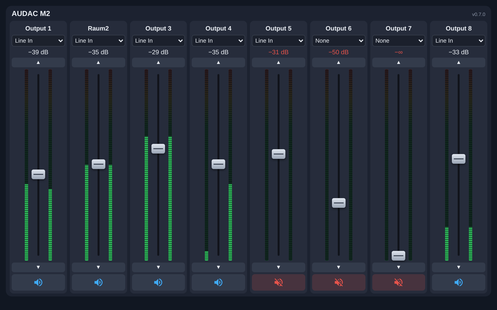
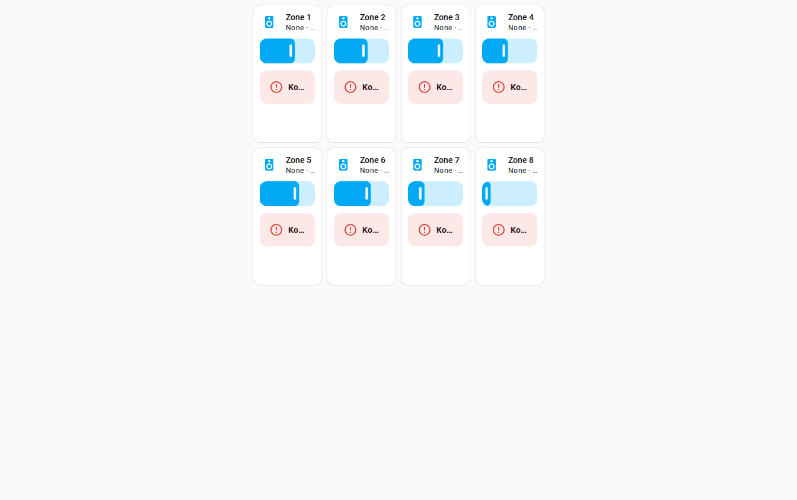
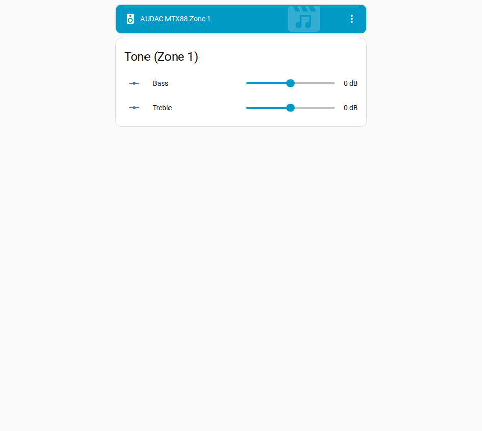
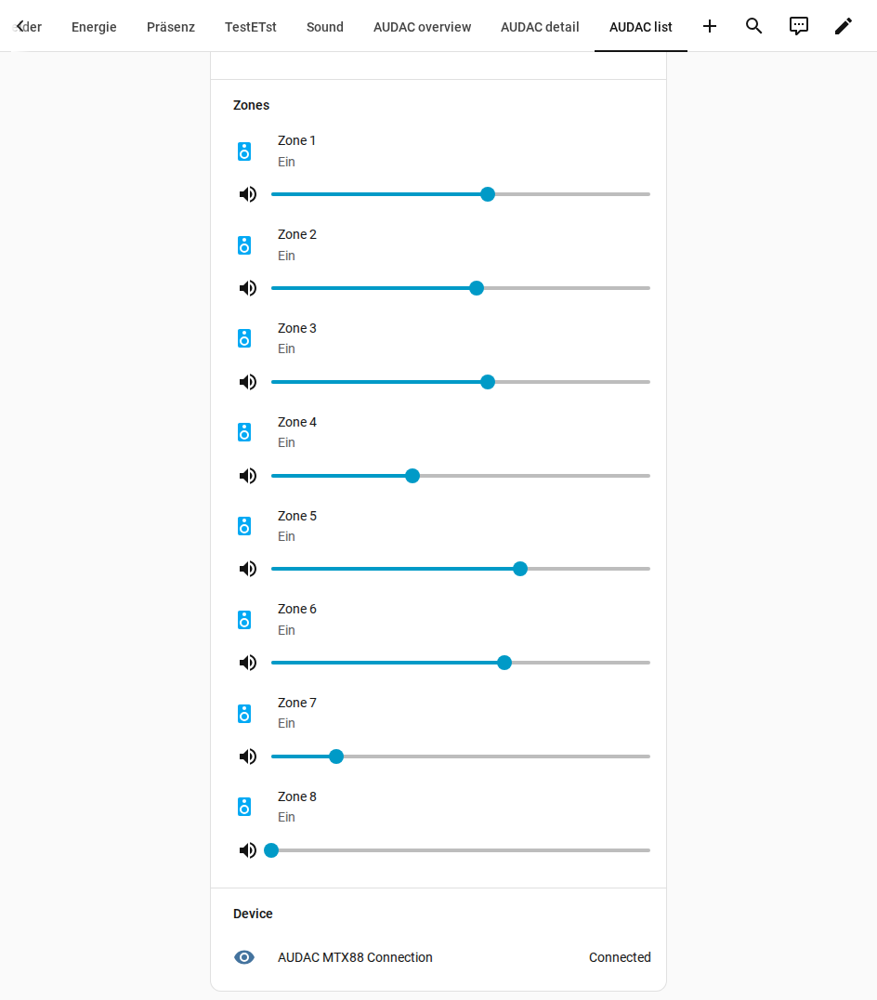

# AUDAC MTX48/88 & M2 — Home Assistant Integration

Native Home Assistant integration for the [AUDAC MTX48 and MTX88](https://audac.eu/eu/products/d/mtx88---8-zone-audio-matrix) multi-zone audio matrices and the **AUDAC M2** multimedia audio mixer, controlled over their TCP/IP protocol on port 5001.

## Features

- **Per-zone media-player entity**: volume, volume-step (3 dB), mute, source select
- **Bass / treble controls** (number entities; MTX -14 to +14 dB in 2 dB steps, M2 -9 to +9 dB in 1 dB steps)
- **M2: zone and input names from the device** — outputs and sources show the names configured in the M2 web UI
- **Model auto-detection** in the config flow (M2 vs. MTX)
- **VU-meter sensors** (10 levels, disabled by default)
- **Save settings & factory-reset** buttons
- **Connection / firmware diagnostics**
- **Push-driven updates** — listens to broadcasts, no constant polling
- **Auto-reconnect with exponential backoff**
- **Lockout-safe**: when the AUDAC Touch app or web UI takes the single permitted TCP slot, the integration shows "disconnected" and reconnects automatically when the slot frees up

## Why a new integration?

The MTX firmware allows **only ONE simultaneous TCP/IP connection** and broadcasts every state change to the active client. Existing community integrations modelled the protocol as simple request/response and crashed in tight loops when other clients connected — this implementation owns one persistent connection, dispatches frames into a state cache, and gracefully steps aside on lockout.

## Requirements

- Home Assistant 2024.7+
- AUDAC MTX48, MTX88 or M2 reachable on your LAN (default port 5001)
- HACS (recommended)

## Installation

### Via HACS (recommended)

1. HACS → ⋮ → **Custom repositories**
2. URL: `https://github.com/SpLord/audac-mtx-ha`, Category: **Integration**
3. Install **AUDAC MTX**, restart Home Assistant
4. Settings → Devices & Services → **+ Add Integration** → search **AUDAC MTX**
5. Enter the device IP and port (5001); leave the model on **auto**

### Manual

Copy `custom_components/audac_mtx/` into your `<config>/custom_components/` directory and restart HA.

## Configuration options

| Field      | Default | Notes                                          |
|------------|---------|------------------------------------------------|
| Host       | —       | IP or hostname of the device                   |
| Port       | 5001    | TCP control port                               |
| Model      | auto    | `auto`, `M2`, `MTX88`, `MTX48` — auto asks the device (GSV on `M001` / `X001`). An MTX is detected as MTX88; choose MTX48 explicitly for 4 zones |
| Source ID  | HA      | 1-4 chars, identifies us in the broadcast log  |

Entries created with earlier versions keep working as MTX (zone count from the old setting).

## Entities created (per device)

| Type          | Count       | Notes                                       |
|---------------|-------------|---------------------------------------------|
| media_player  | 4 or 8      | one per zone (M2: one per output 1–8)       |
| number        | 8 or 16     | bass + treble per zone, dB                  |
| sensor        | 13          | connection, firmware, last error, 10 × VU   |
| button        | 2           | Save settings, Factory reset (disabled)     |

VU sensors and the Last-Error / Firmware diagnostic sensors are **disabled by default** — enable them in the entity registry if you need them.

## Protocol notes

The integration speaks the official AUDAC MTX command protocol on TCP port 5001:

```
Frame: #|destination|source|command|args|U|<CR><LF>
```

Volume values are inverted on the wire (0 = max, 70 = min); we map to/from HA's 0.0-1.0 internally. Bass/treble are 0..14 raw with 7 = 0 dB.

### M2 differences

| | MTX | M2 |
|---|---|---|
| Device address | `X001` | `M001` |
| Volume | 0..70 (0 = max) | 0..100 (0 = max); `150` = output off, shown as minimum |
| Bass / treble | 0..14 raw, 7 = 0 dB | signed dB, -9..+9 |
| Routing update | `R01\|3` | `R01\|000^009` (second field = input) |
| Names | none on the wire | `GZN` (outputs), `GIN` (inputs) |
| Frame end | `CR LF` | `CR LF` + `0x00` |

M2 source list: `None` plus inputs 1–9 (9 = Line In, switched between A–D on the device). Prio inputs, wall-panel, fiber inputs and scenes are shown when a zone is routed to them but are not offered for selection; the test generators (sine/noise) are never offered.

**The M2 forgets all changes on power-off unless they are saved** — press the *Save settings* button (or call `button.press`) after you are happy with a setup. If the M2's DSP load is above 90 % it rejects commands (`L` instead of `+`); HA then shows an error for that action.

The MTX broadcasts an Update frame to every connected client after any state change (its own front-panel knobs, the AUDAC Touch app, wall panels) — so HA stays in sync without polling.

## Mixer card



Since **v0.7.0** the integration ships a mixer card that looks like the AUDAC app: one strip per output with source, level in dB, a vertical fader with ▲/▼ (3 dB steps), mute and — on the M2 — live L/R level meters. Tap the output name for bass/treble.

```yaml
type: custom:audac-mixer-card
# entry_id: …        only needed with more than one AUDAC device
# zones: [1, 2, 3]   optional subset
# height: 600        px, optional (default: full screen in a panel view)
```

- No resource to add: the integration serves the JS itself (the URL carries the version, so tablets pick up updates after a reload). The card shows its version in the top-right corner.
- Channel names and entity IDs come from the integration (`audac_mtx/get_layout`), so the card needs no entity list.
- Level meters are streamed over the websocket (`audac_mtx/subscribe_vu`, ~10/s) and never written to the HA state machine or the recorder.
- The fader follows the finger but never jumps on touch; 0…−60 dB take the upper 85 % of the travel. While dragging, at most 5 volume commands per second go to the device.
- **Save settings** is deliberately not on the card — use the button entity when a setup should survive a power cycle.
- A ready-made panel view is in [`examples/dashboards/mixer.yaml`](examples/dashboards/mixer.yaml).

## Dashboard quickstart

Home Assistant's "Add to Dashboard" button creates basic Tile cards. To get full Tile features (volume slider + source select) for every zone, copy one of the example layouts from [`examples/dashboards/`](examples/dashboards/):

| File | Layout | Preview |
|------|--------|---------|
| `zones-overview.yaml` | 4×2 Tile-card grid with volume slider + source select per zone |  |
| `zone-detail.yaml`    | Single zone with full media-control card + bass/treble sliders |  |
| `zones-compact-list.yaml` | Vertical list, one row per zone (good for mobile sidebars) |  |
| `presets-shortcuts.yaml` | One-tap source-routing presets via the new (HA 2026.5) Shortcut card | — |

Open Lovelace, edit the view (pencil icon top-right), choose **Edit raw configuration** (kebab menu), and paste the YAML inside a `views:` entry. Adjust entity IDs to match your install (default pattern: `media_player.audac_mtx88_zone_<n>` or `..._mtx48_zone_<n>`; on the M2 the output name is used, e.g. `media_player.audac_m2_output_1`, `media_player.audac_m2_raum2`).

> The Tile-card source-select feature requires **v0.5.1+** — earlier versions show a `Konfigurationsfehler` box when a zone is unrouted because source `None` was missing from `source_list`.

## Limitations

- **Single TCP connection** is a hard device limit. While the AUDAC Touch app or web UI is open, this integration is "disconnected" — controls are ignored. Close the other client to regain control.
- M2 zone/input names are read on every (re)connect; friendly names follow, but **entity IDs keep the name they were created with** (rename them in HA if you want new IDs).
- VU-meter mapping: on the M2 the first 16 values are outputs 1–8 as L/R pairs (used by the mixer card). The diagnostic `VU 1`..`VU 10` sensors expose the raw values; the MTX layout is undocumented, so the mixer card shows no meters there.

## Tests

```bash
python -m venv .venv && source .venv/bin/activate
pip install pytest pytest-asyncio pytest-timeout voluptuous
pytest tests
```

Tests use in-process mock MTX and M2 servers — no hardware required.

## License

MIT
